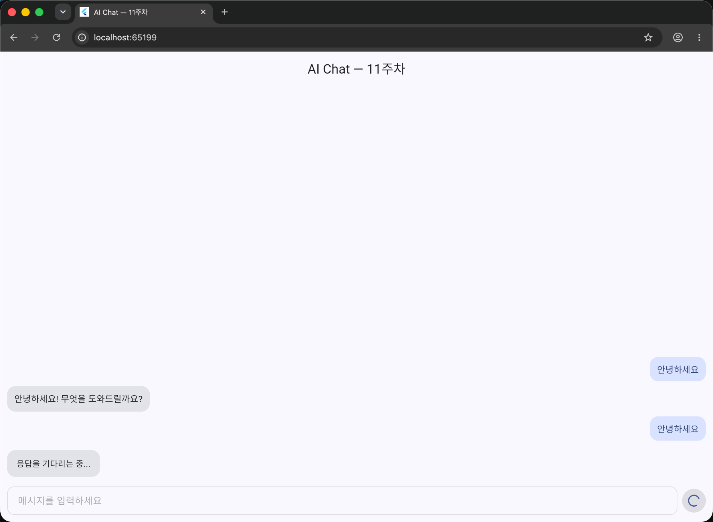
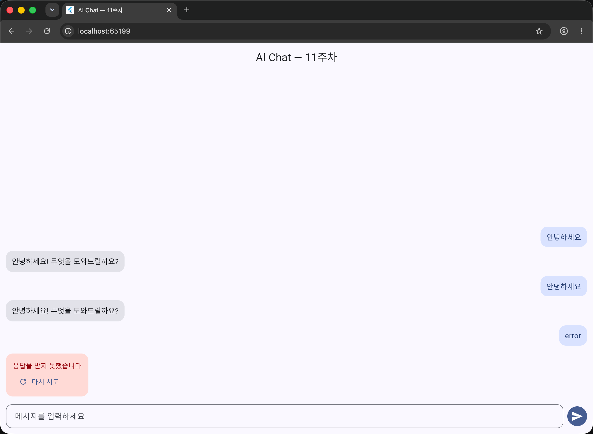

# 실습 1 — 채팅 UI (GAI3008-01 · 11주차)

> 목표: **보내고 받는 모양**을 먼저 만든다. API는 다음 실습에서 붙인다.
> 이 저장소는 **할 일 1번만 완성**되어 있고, 2~5번은 코드 안의 `TODO` 주석으로 안내한다.

## 실행

```bash
flutter pub get
flutter run -d chrome      # 또는 -d <에뮬레이터>
```

서버가 필요 없다. `_messages`에 들어 있는 가짜 대화로 화면만 만든다.

## 할 일

| # | 내용 | 상태 |
|---|---|---|
| 1 | `ListView.builder` + `reverse: true` — 최신이 아래 | ✅ **완성됨** |
| 2 | 말풍선 2종 — 사용자 오른쪽 / AI 왼쪽 | ⬜ `TODO 2` |
| 3 | 입력창 `TextField` + 전송 버튼 | ⬜ `TODO 3` |
| 4 | 빈 상태 — "무엇이든 물어보세요" | ⬜ `TODO 4` |
| 5 | 키보드가 입력창을 가리지 않게 | ⬜ `TODO 5` |

`lib/main.dart`에서 `TODO 2`~`TODO 5`를 검색하면 해당 위치로 바로 간다.

## 완료 기준 (수업 중 통과)

- 말풍선이 **좌우로** 나뉜다
- 입력창이 화면 **아래**에 붙어 있다
- 목록이 비면 **빈 상태 문구**가 보인다
- 키보드가 올라와도 입력창이 **가려지지 않는다**

## 힌트

- `reverse: true`면 index 0이 **화면 맨 아래**다. 그래서 `_messages[length - 1 - i]`로 꺼낸다.
- 색은 `Theme.of(context).colorScheme`에서 꺼내면 다크 모드에서도 안전하다.
- `TextEditingController`는 `dispose()`에서 정리한다.
- `ListView`를 `Stack`으로 감싸면 빈 상태를 위에 겹칠 수 있다.

## 구조

```
lib/main.dart          ← 실습 파일 (TODO 2~5)
test/widget_test.dart  ← 앱이 뜨는지 확인하는 스모크 테스트
```

## 제출

- 이 저장소를 `fork` → 브랜치 `feat/내이름-chat`
- 커밋 2개 이상, PR 1개
- PR 본문 3줄: 무엇 · 왜 · 시험

---

ⓒ 2026 Baryon Labs · 연세대학교 GAI3008-01 응용모바일프로그래밍 교육자료

## 11주차 과제 — 채팅 UI 및 오류·재시도 구현

### 1. 과제 개요

Flutter를 이용하여 채팅 UI를 구현하고, 메시지 전송부터 응답 대기, 응답 표시, 오류 발생 및 재시도까지의 과정을 완성하였다.

이번 실습에서는 실제 AI API 대신 로컬 MOCK 응답을 사용하여 채팅 상태와 애니메이션을 테스트하였다.

### 2. 구현 기능

**실습 1 — 채팅 UI**
- `ListView.builder`의 `reverse: true` 방식으로 채팅 메시지 표시
- 사용자 메시지는 오른쪽, AI 메시지는 왼쪽에 배치
- `TextField`와 전송 버튼으로 메시지 입력 및 전송
- 메시지가 없을 때 `무엇이든 물어보세요` 표시
- `SafeArea`와 `resizeToAvoidBottomInset`을 이용한 입력창 배치

**응답 상태 및 애니메이션**
- 메시지 전송 후 약 2초 동안 MOCK 응답 대기
- `AnimationController`를 이용한 타이핑 점 3개 표시
- `AnimatedList`와 `SizeTransition`을 이용한 250ms 메시지 삽입 애니메이션
- 새 메시지가 추가되면 최신 메시지 위치로 스크롤
- Reduce Motion 설정 시 불필요한 애니메이션 생략

**실습 4 — 오류와 재시도**
- 401, 429, 500 및 timeout 오류 상황 시뮬레이션
- 오류 메시지와 `다시 시도` 버튼 표시
- 마지막 사용자 메시지를 이용한 재시도
- 응답 대기 중 중복 전송 방지

### 3. 실행 화면

**① 정상 채팅 및 AI 응답**



**② AI 응답 대기 애니메이션**


**③ 오류 메시지 및 재시도**



### 4. 실행 방법

```bash
flutter pub get
flutter run -d chrome
```

별도의 API 키 없이 로컬 MOCK 모드로 실행할 수 있다.

### 5. 테스트 결과

| 테스트 항목 | 결과 |
|---|---|
| 메시지 입력 및 전송 | 통과 |
| AI MOCK 응답 | 통과 |
| 타이핑 애니메이션 | 통과 |
| 500 오류 및 재시도 | 통과 |
| 401 권한 오류 | 통과 |
| 429 요청 제한 오류 | 통과 |
| Timeout 오류 | 통과 |
| 빈 메시지 및 중복 전송 방지 | 통과 |
| Reduce Motion | 통과 |

### 6. 실습 회고

**1. 만든 것**

채팅 메시지 입력과 전송, AI 응답 대기 표시, 메시지 삽입 애니메이션, 오류 및 재시도 기능을 구현하였다.

**2. 어려웠던 점**

처음에는 메시지가 일반 텍스트로 표시되었고, 입력창을 추가한 뒤에도 메시지가 정상적으로 전송되지 않았다. 이후 상태 관리와 메시지 목록 갱신 과정을 수정하였다.

**3. 해결 방법**

`setState()`를 통해 메시지 목록을 갱신하고, `AnimatedList`의 `insertItem()`을 사용하여 새로운 메시지가 부드럽게 표시되도록 하였다. 오류 발생 시에는 오류 상태를 화면에 표시하고 재시도 기능을 추가하였다.

**4. 다음 단계**

실제 AI API 연결을 통해 MOCK 응답을 실제 모델 응답으로 변경하고, 채팅 상태 관리를 확장할 예정이다.

**5. 구현 증거**

Git Commit 기록과 정상 채팅, 타이핑 애니메이션, 오류 및 재시도 화면을 README에 첨부하였다.